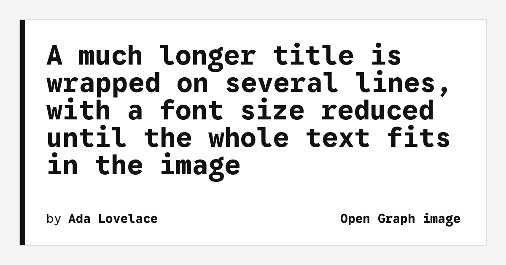

# Open Graph image component theme

The _Open Graph image_ component theme for [Cecil](https://cecil.app) generates the image displayed when a page is shared (social networks, messaging apps): the title of the page, its author and the title of the site, drawn on a background image.



**[Demo](https://cecilapp.github.io/theme-ogimage/)**

## Features

- An image for each page (`og.png`, 1200 × 628), published next to the page
- An image for the site (title and description), used by the homepage
- An image for each section (title and description), like the one of the site
- Nothing generated for a page (or a site) which already has an `image`
- Title wrapped on several lines, with a font size adapted to its length
- Custom background, fonts, text color and padding, for the whole site, a section or a page
- Multilingual: texts and options of each language
- Images are cached: they are only generated again when a text or an option changes

## Requirements

- Cecil 9.25 or later, with [plugins](https://cecil.app/documentation/developers/extend/#plugins) support: the `og_image()` function is registered by the `OgImage\Plugin` plugin
- PHP GD extension with FreeType support (without it, a warning is logged and no image is generated)

## Installation

Allow the theme installer plugin in the `composer.json` file of your Cecil project (required since Composer 2.2):

```json
{
  "config": {
    "allow-plugins": {
      "cecil/theme-installer": true
    }
  }
}
```

Then require the theme:

```bash
composer require cecil/theme-ogimage
```

> Or [download the latest archive](https://github.com/Cecilapp/theme-ogimage/releases/latest/) and uncompress its content in `themes/ogimage`.

## Usage

Add `ogimage` in the `theme` section of your configuration file (`cecil.yml`):

```yaml
theme:
  - ogimage
```

Then give the generated image to the [metatags partial](https://cecil.app/documentation/configuration/site/#metatags) in the `<head>` of your base layout, with the `image` variable:

```twig
{{ include('partials/metatags.html.twig', {page, site, image: og_image(page)}, with_context = false) }}
```

### The `og_image()` function

`og_image(page)` returns the image as an [asset](https://cecil.app/documentation/assets/#asset), or `null` when there is nothing to generate: the metatags partial then uses the `image` of the page or of the site, as usual.

| Page                                                        | Image                                                         |
|-------------------------------------------------------------|---------------------------------------------------------------|
| With an `image` in its front matter                         | None (`null`): the image of the page is used                  |
| With `ogimage: false` in its front matter                   | None (`null`)                                                 |
| Homepage, and pages out of the [`sections`](#sections)      | Image of the site, or none if the site has an `image`         |
| Section (list of its pages, e.g. `blog/index.md`)           | Image of the section: its title and its description           |
| Other pages                                                 | Image of the page: its title, its author and the site title   |

The site title of the images of the pages can be hidden with the `site_title` option (e.g. on a personal website, where the site title is the name of the author).

Without argument, `og_image()` returns the image of the site.

The author is the `author` of the page, otherwise the one of the site (a name, or a map with a `name` key).

The description of a section is the `description` in the front matter of its `index.md`, otherwise the one of the site. The image of a section gets the style of the section, and is generated only if the section is in the [`sections`](#sections) (otherwise it gets the image of the site).

As the function returns an asset, the image can also be displayed in a page:

```twig




```

### Configuration

Default options, registered by the plugin:

```yaml
ogimage:
  enabled: true                      # `false` to disable the generation
  sections: []                       # sections of the pages with their own image (all pages if empty), and their style
  background: ogimage/background.png # background image (asset path), resized to 1200 × 628
  color: '#111111'                   # text color (hexadecimal)
  fonts:                             # TrueType fonts (asset paths)
    regular: ogimage/fonts/GoogleSansCode-Regular.ttf
    bold: ogimage/fonts/GoogleSansCode-Bold.ttf
  padding:                           # space around the text, in pixels
    top: 105
    right: 110
    bottom: 100
    left: 110
  by: by                             # text before the name of the author
  site_title: true                   # `false` to hide the site title from the images of the pages
```

For example, to generate an image for blog posts only, with your own background:

```yaml
ogimage:
  sections: [blog]
  background: images/og-background.png
  padding:
    left: 80
```

#### Sections

The `sections` option sets which pages have their own image (their title, their author and the site title): the other pages get the image of the site (its title and its description). The homepage always gets the image of the site.

The section of a page is the top-level directory of the page in `pages/` (e.g. `blog` for `pages/blog/2026/post.md`): a sub-directory can't be selected. Names are case-sensitive.

With the following pages:

```text
pages/
├── index.md       # homepage
├── about.md       # out of any section
├── blog/
│   ├── index.md   # list of the "blog" section
│   └── post.md
└── docs/
    └── install.md
```

| `sections`     | Image of the page                       | Image of the site                           |
|----------------|-----------------------------------------|---------------------------------------------|
| `[]` (default) | `about.md`, `blog/*`, `docs/*`          | `index.md`                                  |
| `[blog]`       | `blog/index.md`, `blog/post.md`         | `index.md`, `about.md`, `docs/install.md`   |
| `[blog, docs]` | `blog/*`, `docs/*`                      | `index.md`, `about.md`                      |

When the site has an `image` in its configuration, nothing is generated for the pages which get the image of the site: `og_image()` returns `null`, and the metatags partial uses the `image` of the site:

```yaml
image: images/og-site.jpg # used by the homepage, about.md and docs/install.md
ogimage:
  sections: [blog]        # an image is generated for the blog pages only
```

Whatever the `sections`, a page with an `image` or `ogimage: false` in its front matter has no generated image.

#### Style of a section

`sections` can also be a map of the sections and their style: the options `background`, `color`, `fonts`, `padding`, `by` and `site_title` of a section override those of the site, for the images of its pages. A section without option (`~`) uses the style of the site.

```yaml
ogimage:
  sections:
    blog: ~                              # style of the site
    docs:
      background: images/og-docs.png     # background of the "docs" section
      color: '#ffffff'
      padding:
        left: 80                         # the other sides keep the padding of the site
```

#### Style of a page

The style of a page can be set by an `ogimage` map in its front matter, with the same options: they override those of the section and of the site.

```yaml
---
title: My post
ogimage:
  background: images/og-special.png
  color: '#ffc400'
---
```

To give a style to all the pages of a section without changing the configuration, set it in the [`cascade`](https://cecil.app/documentation/content/) variable of the front matter of the section (its `index.md`):

```yaml
---
title: Docs
cascade:
  ogimage:
    background: images/og-docs.png
---
```

A page with its own `ogimage` map doesn't get the one of the `cascade` (the maps aren't merged).

The style of a section or of a page only applies to the images of the pages: the pages which get the image of the site (homepage, pages out of the `sections`) use the style of the site.

The background and the fonts are [assets](https://cecil.app/documentation/assets/): set a path in the `assets` (or `static`) directory of your site, or override the default files by creating a file with the same path (e.g. `assets/ogimage/background.png`).

### Internationalization

The title and the description of the site, and the options of the theme, are those of the language of the page: translate the text before the author in the configuration of the language.

```yaml
languages:
  - code: fr
    name: Français
    locale: fr_FR
    config:
      ogimage:
        by: par
```

The images of a language are published in its directory (e.g. `/fr/blog/post/og.png`).

### Use it in a theme

A visual theme can require this component theme, so its users have nothing to configure (Cecil 9.29 or later). Add it to the `require` section of the `composer.json` of the theme:

```json
{
  "require": {
    "cecil/theme-ogimage": "^1.0"
  }
}
```

Then require it in the `config.yml` of the theme, with the options of the theme (background, fonts, colors…):

```yaml
theme:
  - ogimage
ogimage:
  background: <theme>/og-background.png
```

## Development

Run the demo website with the theme under development:

```bash
php demo/link.php
php cecil.phar serve demo
```

## License

_Open Graph image_ is a free software distributed under the terms of the MIT license.

The default fonts, [Google Sans Code](https://github.com/googlefonts/googlesans-code), are distributed under the terms of the [SIL Open Font License](assets/ogimage/fonts/OFL.txt).
